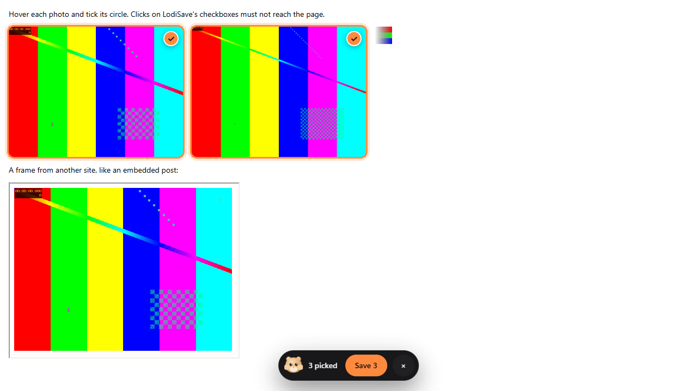
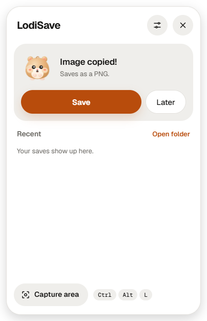
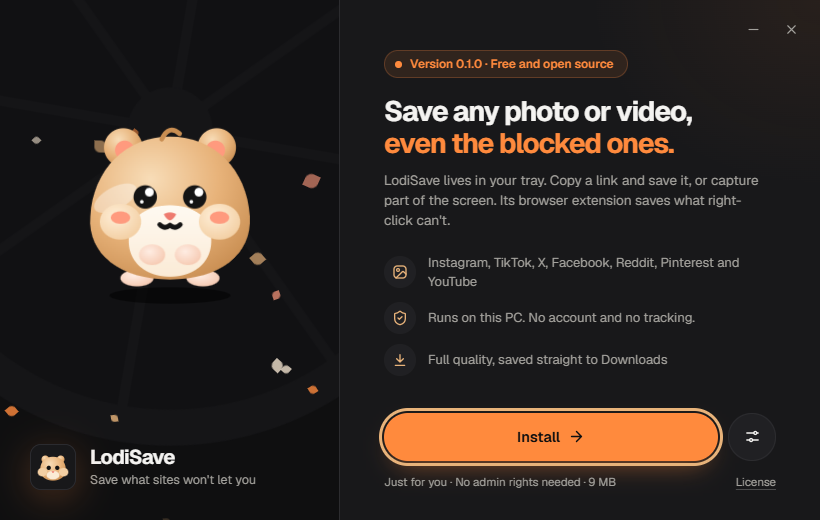

<p align="center"></p>

# LodiSave

Save the photos and videos that sites won't let you save.

LodiSave is a Windows tray app and a browser extension for Chrome and Edge. Right-click blocked, an invisible layer over the picture, a video that only streams: LodiSave gets the file anyway, in its original quality.

<p align="center"></p>

## Features

- **Hover picker.** Hover a photo or video on any site and tick the round checkbox at its top right. Tick several, then save them all from the bar at the bottom. Works under click-blocking overlays and inside embedded frames.
- **Popup grid.** The toolbar button lists every image, video and stream on the page, biggest first.
- **Shift + right-click** opens the menu on pages that block it. "Save with LodiSave" saves what's under the pointer.
- **Streams.** Saves MediaSource, HLS and DASH video, and joins separate video and audio into one MP4. Asks X and Pinterest for the full-size original.
- **Tray app.** Copy a link from Instagram, TikTok, X, Facebook, Reddit or YouTube, click Lodi in the tray and save it. It also saves a copied image, and Ctrl+Alt+L captures a window or area of the screen.
- English or Taglish, light and dark, motion on or off.

<p align="center"> </p>

## Install

1. Download `LodiSave-Setup-0.2.3.exe` from [Releases](https://github.com/jherobred/LodiSave/releases). The builds aren't code-signed yet, so SmartScreen may warn: choose More info, then Run anyway.
2. For the browser extension, choose Set up extension when Setup finishes, or Settings, then Browser extension, Set up in the tray panel. LodiSave opens a new Chrome, Edge or Brave window with the Extensions address copied, and keeps a checklist on screen: press Ctrl+V and Enter in the address bar, turn on Developer mode, click Load unpacked, then choose Copy folder, press Ctrl+V and Select Folder. Browsers only let apps install extensions from their stores, and they won't open their Extensions page for another app, so these clicks stay yours. The same files are in `LodiSave-extension-0.2.3.zip`.

`LodiSave-0.2.3-portable.exe` runs without installing.

Saves go to `Downloads\LodiSave`. If Windows Security's Controlled folder access protects Downloads, allow LodiSave under Ransomware protection.

## Android

The Android app in `android/` saves the same way, without a browser:

- **Share** a link, photo or video to LodiSave from any app. Lodi floats up while it saves. Threads, Instagram, X, Facebook, TikTok and YouTube share links all save the original file.
- **Pick from a post.** A post with several photos or videos shows them all with round checkboxes, like the PC picker. Tick some or all, then save at once.
- **Several at once.** Share or paste more links while one is saving. They save side by side, each with its own bar.
- **Floating Lodi** (Settings) sits over every app. Tap Copy link on a post, then tap Lodi, and he saves the original file. Drag him to either edge, hold him to hide him.
- **Pick in other apps** (Settings, then turn on LodiSave picker in Android's Accessibility settings). Tap the floating Lodi in Threads, Instagram, Reddit or any app and a round checkbox shows on each photo and video, like the PC picker. Ticking one presses that post's Share, then Copy link, for you; Save saves the original files, only the photos you ticked from a carousel. Android may call the setting restricted for an app installed from a file: open App info, tap ⋮, then Allow restricted settings.
- Reddit posts, galleries and videos save through the embed page Reddit makes for other sites.
- **The round home-screen widget** saves the link you copied in one tap.
- Saves go to `Pictures/LodiSave`, `Movies/LodiSave` and `Music/LodiSave`, so the gallery shows them.
- Separate video and audio are joined with Android's own MediaMuxer, so there's no FFmpeg here either.

Install `LodiSave-0.2.3-android.apk` from [Releases](https://github.com/jherobred/LodiSave/releases) (allow installs from your browser or file manager when Android asks). YouTube's challenges run in [QuickJS](https://github.com/quickjs-ng/quickjs), which ships inside the app.

## Limits

- DRM-protected video is refused. LodiSave doesn't decrypt.
- The extension skips YouTube, as Chrome Web Store rules require. The tray app saves YouTube links.
- A stream saves what the player has loaded. Play it to the end to save all of it.
- Posts behind a login need the extension in your signed-in browser. Reddit now needs a login for every video.
- Some sites block whole networks or regions (TikTok blocks some posts by IP, Rumble and Newgrounds refuse many networks). LodiSave says so instead of failing silently.

## Privacy

Everything runs on your PC, with no account and no analytics. The first time you save a link, the tray app downloads [yt-dlp](https://github.com/yt-dlp/yt-dlp) from its GitHub releases, and it checks for a yt-dlp update once a week.

## Build

Needs Windows, Node 20+, Rust 1.90+, Microsoft Edge and FFmpeg on PATH (the tests make their media with it).

```bash
npm install
npm test
cargo test --release --manifest-path app/Cargo.toml
pwsh scripts/build-release.ps1
```

The Android app needs JDK 17+, the Android SDK (platform 36) and Python 3.14 on the build machine, which Chaquopy uses to package the app's Python:

```bash
cd android
./gradlew assembleDebug
```

QuickJS is checked in as `android/app/src/main/jniLibs/<abi>/libqjs.so`. `pwsh scripts/build-quickjs.ps1` rebuilds it from source with the Android NDK.

`npm test` runs the extension on local fixture pages in Edge and checks every saved file against its original. The release script writes the installer, the portable app, the extension zip and `SHA256SUMS.txt` to `dist/`.

| Folder | What |
|---|---|
| `extension/` | Browser extension, Manifest V3, no dependencies |
| `app/` | Tray app, Tauri 2 and Rust |
| `installer/` | Setup and uninstaller, Rust and WebView2 |
| `android/` | Android app, Kotlin, Compose and Chaquopy |
| `fixtures/` | Test pages and the end-to-end check |
| `brand/` | Icon sources and the script that renders them |

## License

MIT. The Geist fonts are under the SIL Open Font License 1.1. yt-dlp is under the Unlicense and is downloaded at first use, not bundled.

Save only what you have the right to keep, and respect creators and each site's terms.
