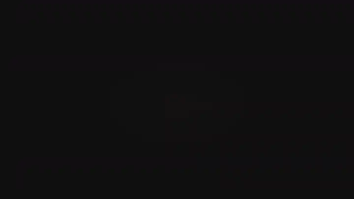
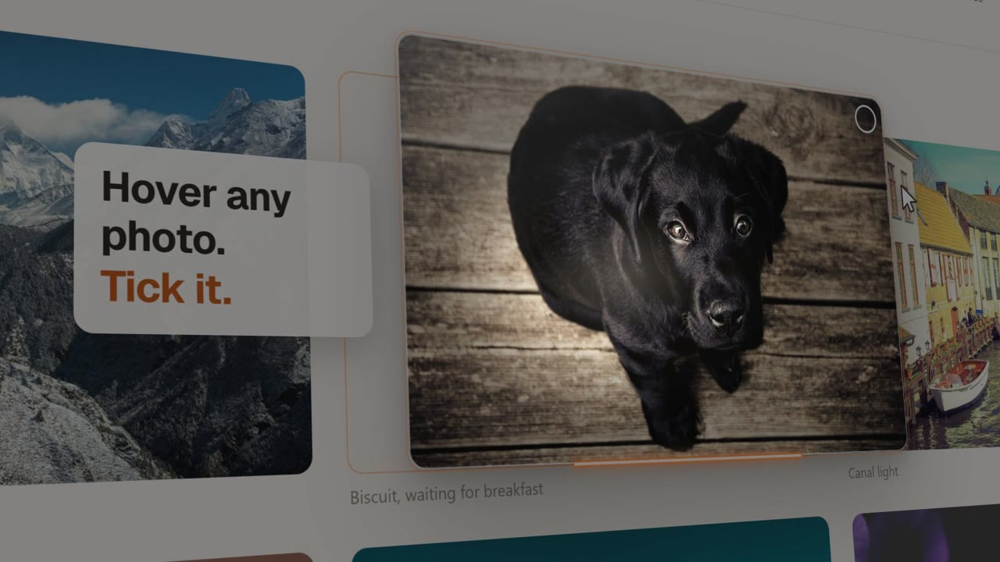
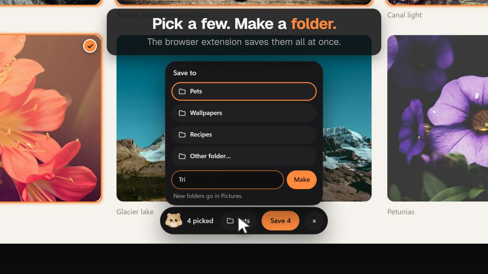
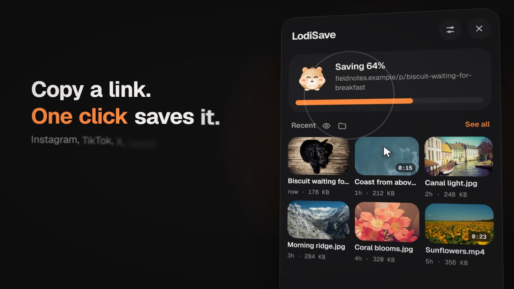
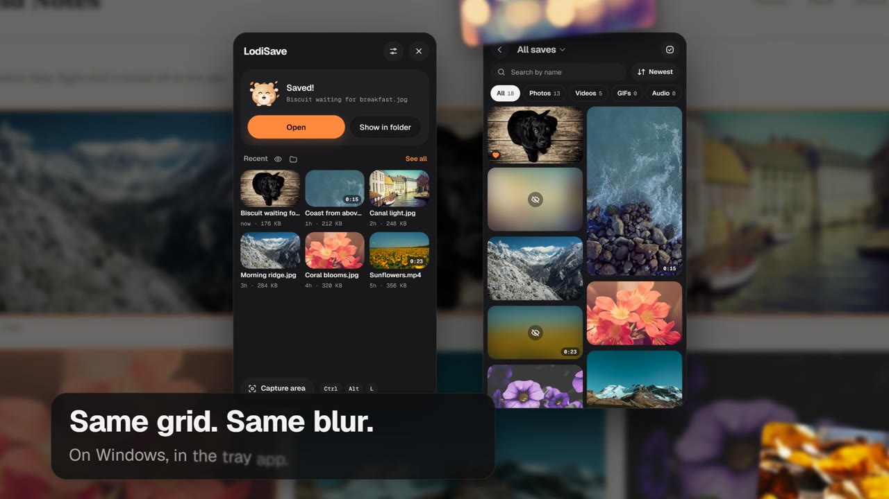
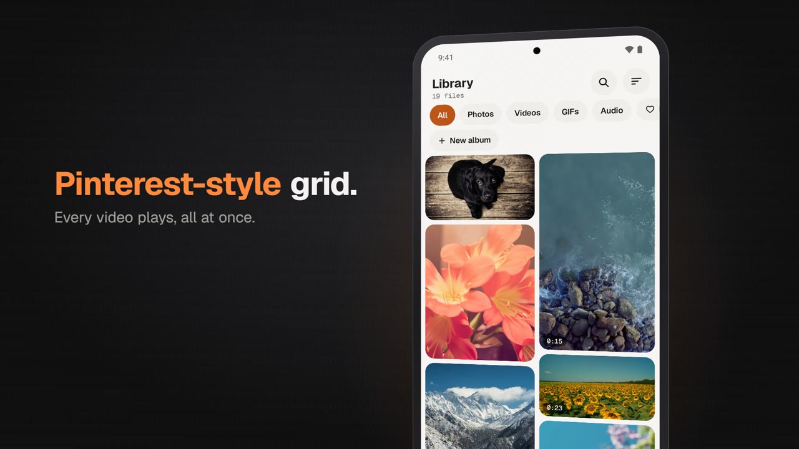
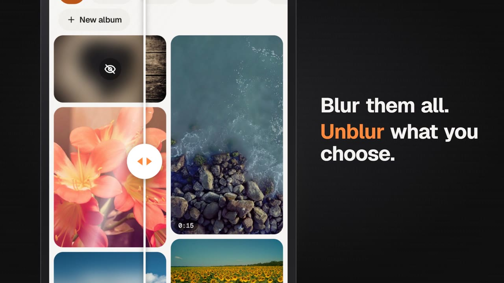
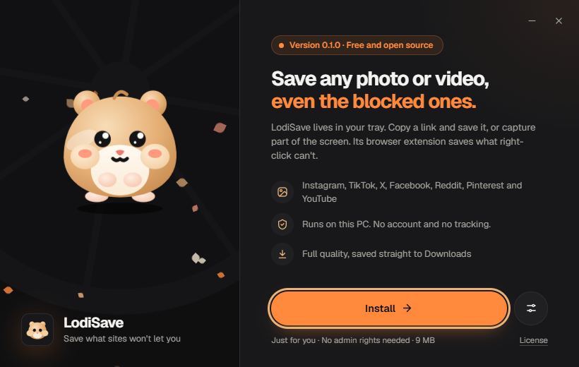

<p align="center"></p>

<h1 align="center">LodiSave</h1>

<p align="center"><b>Save the photos and videos that sites won't let you save.</b><br>
Right-click blocked, an invisible layer over the picture, a video that only streams: Lodi gets the file anyway, in its original quality.</p>

<p align="center">
  <a href="https://github.com/jherobred/LodiSave/releases/latest"></a>
  <a href="https://github.com/jherobred/LodiSave/releases"></a>
  
  <a href="LICENSE"></a>
</p>

<p align="center">
  <a href="https://github.com/jherobred/LodiSave/releases/latest"><b>Download</b></a> ·
  <a href="#windows-and-the-browser">Windows</a> ·
  <a href="#android">Android</a> ·
  <a href="#install">Install</a> ·
  <a href="#build">Build</a>
</p>

> [!WARNING]
> **Windows will say this is a virus. It's not, I promise 😭**
> I just don't have the paid code-signing certificate that makes Windows trust an app, so SmartScreen panics at anything unsigned. Click **More info**, then **Run anyway**. Every line of code is right here if you want to check.

<p align="center">
  <a href="https://github.com/jherobred/LodiSave/releases/download/v0.3.1/LodiSave-promo.mp4"></a>
  <br><sub>Click for the full video with sound (37 s).</sub>
</p>

## What's new in 0.3

- **Save into any folder.** Tick several photos and videos, press Save once, and they all land in the folder you pick. Make a new folder right from the save bar.
- **Pinterest-style grid** on Android and Windows: two a row, each save in its own shape. Or keep Squares, three a row.
- **Blur** your saves on both apps: blur everything, or only the ones you pick. Hold a save (right-click on Windows) to blur or unblur it.
- **Videos play in the grid**, silently and smoothly, all at once.
- **Android Gallery tab**, **Google Drive backup**, **profile browsing** for Instagram and Threads, and **background sounds**. See [Android](#android).
- Saves Snapchat stories, TikTok photo posts and Facebook stories from their links.

## Windows and the browser

<table>
<tr>
<td width="50%"></td>
<td width="50%"></td>
</tr>
<tr>
<td><b>Hover any photo. Tick it.</b><br>A round checkbox shows on every photo and video, even under click-blocking overlays and inside embedded frames.</td>
<td><b>Pick a few. Make a folder.</b><br>Save them all at once, into Last folder, One folder, Ask for each, or Downloads.</td>
</tr>
<tr>
<td></td>
<td></td>
</tr>
<tr>
<td><b>Copy a link. One click saves it.</b><br>Instagram, TikTok, X, Facebook, Reddit, YouTube and more, from Lodi in the tray.</td>
<td><b>A library for your saves.</b><br>Albums, favorites, search, a viewer, blur, and quick edits saved as copies.</td>
</tr>
</table>

- **Popup grid.** The toolbar button lists every image, video and stream on the page, biggest first.
- **Shift + right-click** opens the menu on pages that block it. "Save with LodiSave" saves what's under the pointer.
- **Streams.** Saves MediaSource, HLS and DASH video, and joins separate video and audio into one MP4. Asks X and Pinterest for the full-size original.
- **Clipboard and screen.** Saves a copied image, and Ctrl+Alt+L captures a window or area of the screen.
- **Edits as copies.** Rotate, flip, crop and convert photos. With FFmpeg installed, trim videos and turn videos into GIFs and back.
- **Sign in** to Instagram, Threads, Facebook, X, TikTok or Reddit (Settings, then Accounts) for stories and posts your account can see. You type your password on the site's own page. LodiSave keeps only the sign-in cookie, encrypted by Windows.
- **Gaming mode.** When a full-screen game runs, LodiSave and its downloads drop to low priority and its pop-ups wait.
- English or Taglish ("Na-save na, lodi!"), light and dark, motion on or off.

## Android

<table>
<tr>
<td width="50%"></td>
<td width="50%"></td>
</tr>
<tr>
<td><b>Pinterest-style grid.</b><br>Every video plays, all at once.</td>
<td><b>Blur them all.</b><br>Unblur what you choose.</td>
</tr>
</table>

- **Share** a link, photo or video to LodiSave from any app. Lodi floats up while it saves.
- **Pick from a post.** A post with several photos or videos shows them all with round checkboxes. Tick some or all, then save at once.
- **Floating Lodi** sits over every app. Tap Copy link on a post, then tap Lodi. With the LodiSave picker on in Accessibility settings, tapping Lodi puts a checkbox on each photo and video in Threads, Instagram, Reddit or any app.
- **Home, Library and Gallery tabs.** The Gallery shows every photo and video on your phone, with albums, favorites, moving, sharing and deleting. Hold a photo and slide across others to select them all.
- **Browse a profile.** Type a username to see an Instagram account's stories, highlights and posts (signed in), or a Threads account's posts, then pick and save. Stories are never marked seen.
- **Google Drive backup.** Back up the saves you pick, or everything older than a set number of days. Optionally free up the phone once Drive confirms the upload.
- **Background sounds.** Play the sound of other videos and songs behind the one you're watching, even with the screen off.
- **Viewer.** Swipe down to close, rotate photos, videos and GIFs, and keep a turned copy.
- **Round home-screen widget** saves the link you copied in one tap.
- Saves go to `Pictures/LodiSave`, `Movies/LodiSave` and `Music/LodiSave`, so the gallery shows them. Video and audio are joined with Android's own MediaMuxer.

## Install

**Windows**

1. Download `LodiSave-Setup-0.3.1.exe` from [Releases](https://github.com/jherobred/LodiSave/releases/latest). When SmartScreen warns, choose More info, then Run anyway.
2. For the browser extension, choose Set up extension when Setup finishes, or Settings, then Browser extension, Set up in the tray panel. LodiSave opens Chrome, Edge or Brave with a checklist on screen: paste the Extensions address, turn on Developer mode, click Load unpacked, and paste the folder. Browsers only let apps install extensions from their stores, so these clicks stay yours. The same files are in `LodiSave-extension-0.3.1.zip`.

`LodiSave-0.3.1-portable.exe` runs without installing. Saves go to `Downloads\LodiSave`. If Windows Security's Controlled folder access protects Downloads, allow LodiSave under Ransomware protection.

<p align="center"></p>

**Android**

Install `LodiSave-0.3.1-android.apk` (Android 10+, arm64) from [Releases](https://github.com/jherobred/LodiSave/releases/latest), and allow installs from your browser or file manager when Android asks. Android may call the picker setting restricted for an app installed from a file: open App info, tap ⋮, then Allow restricted settings.

## Limits

- DRM-protected video is refused. LodiSave doesn't decrypt.
- The extension skips YouTube, as Chrome Web Store rules require. The apps save YouTube links.
- A stream saves what the player has loaded. Play it to the end to save all of it.
- Posts behind a login need the extension in your signed-in browser, or a sign-in in the app. Reddit now needs a login for every video.
- Some sites block whole networks or regions (TikTok blocks some posts by IP, Rumble and Newgrounds refuse many networks). LodiSave says so instead of failing silently.

## Privacy

Everything runs on your device, with no LodiSave account, no servers and no analytics. The apps download [yt-dlp](https://github.com/yt-dlp/yt-dlp) from its GitHub releases on first use and check for an update once a week. Sign-in cookies go only to the site they came from. Drive backup sends files only to your own Google Drive, and only when you turn it on.

## Build

Needs Windows, Node 20+, Rust 1.90+, Microsoft Edge and FFmpeg on PATH (the tests make their media with it).

```bash
npm install
npm test
cargo test --release --manifest-path app/Cargo.toml
pwsh scripts/build-release.ps1
```

The Android app needs JDK 17+, the Android SDK (platform 36) and Python 3.14 on the build machine, which Chaquopy uses to package the app's Python:

```bash
cd android
./gradlew assembleDebug
```

QuickJS is checked in as `android/app/src/main/jniLibs/<abi>/libqjs.so`. `pwsh scripts/build-quickjs.ps1` rebuilds it from source with the Android NDK.

`npm test` runs the extension on local fixture pages in Edge and checks every saved file against its original. The release script writes the installer, the portable app, the extension zip and `SHA256SUMS.txt` to `dist/`.

| Folder | What |
|---|---|
| `extension/` | Browser extension, Manifest V3, no dependencies |
| `app/` | Tray app, Tauri 2 and Rust |
| `installer/` | Setup and uninstaller, Rust and WebView2 |
| `android/` | Android app, Kotlin, Compose and Chaquopy |
| `fixtures/` | Test pages and the end-to-end check |
| `brand/` | Icon sources and the script that renders them |

## License

MIT. The Geist fonts are under the SIL Open Font License 1.1. yt-dlp is under the Unlicense and is downloaded at first use, not bundled.

Save only what you have the right to keep, and respect creators and each site's terms.
